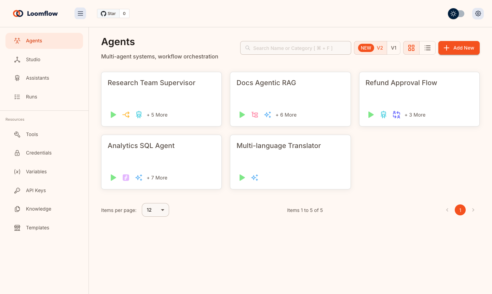
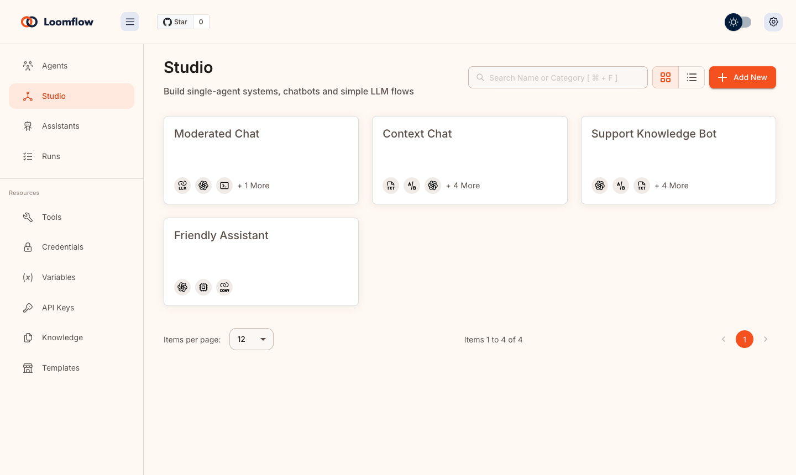
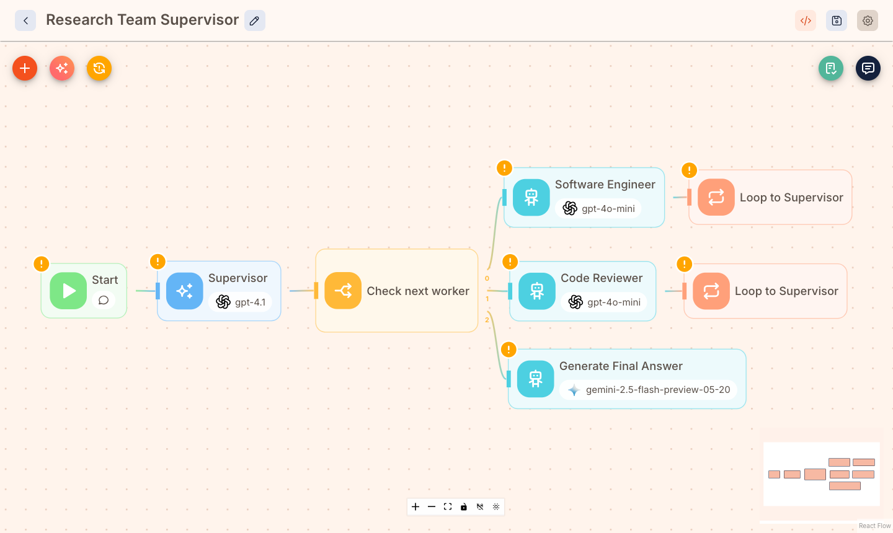
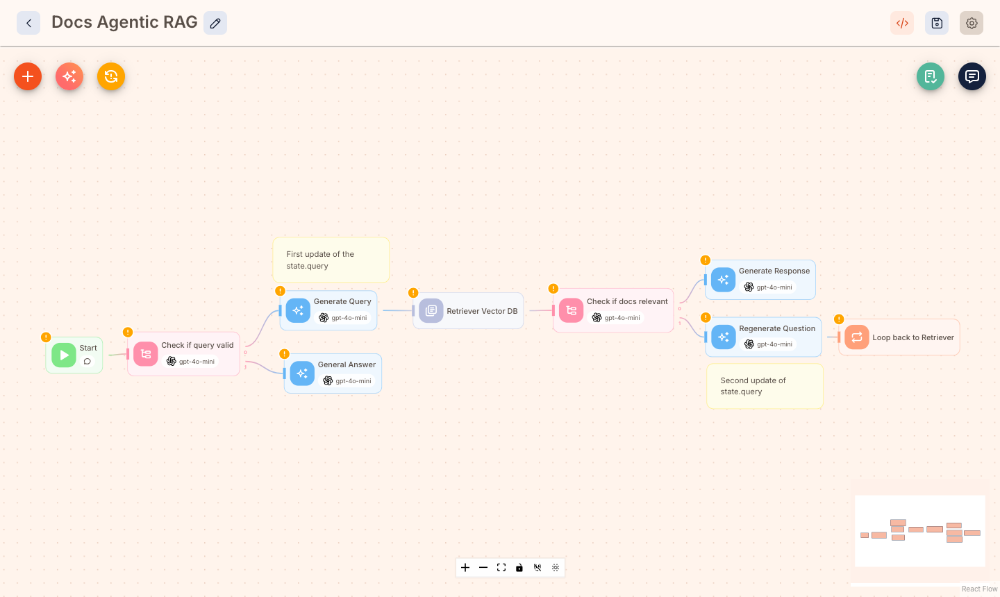
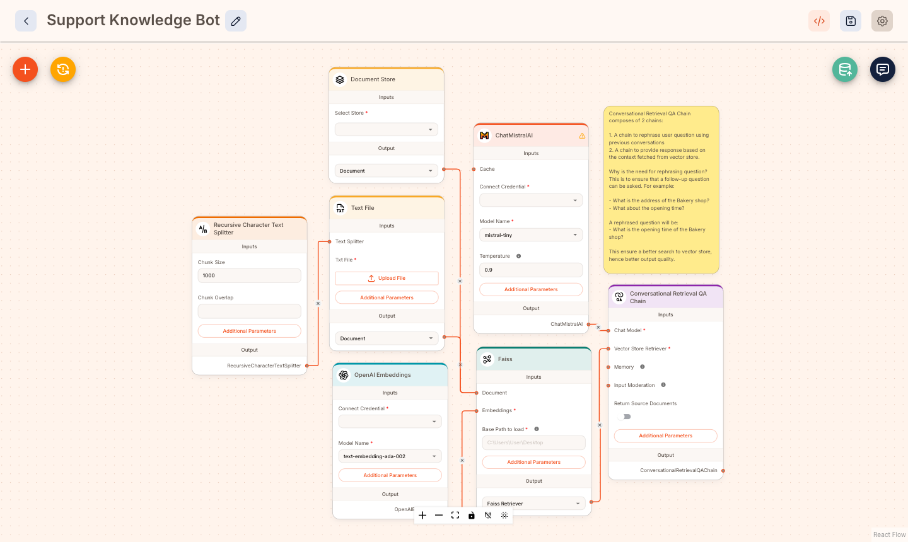
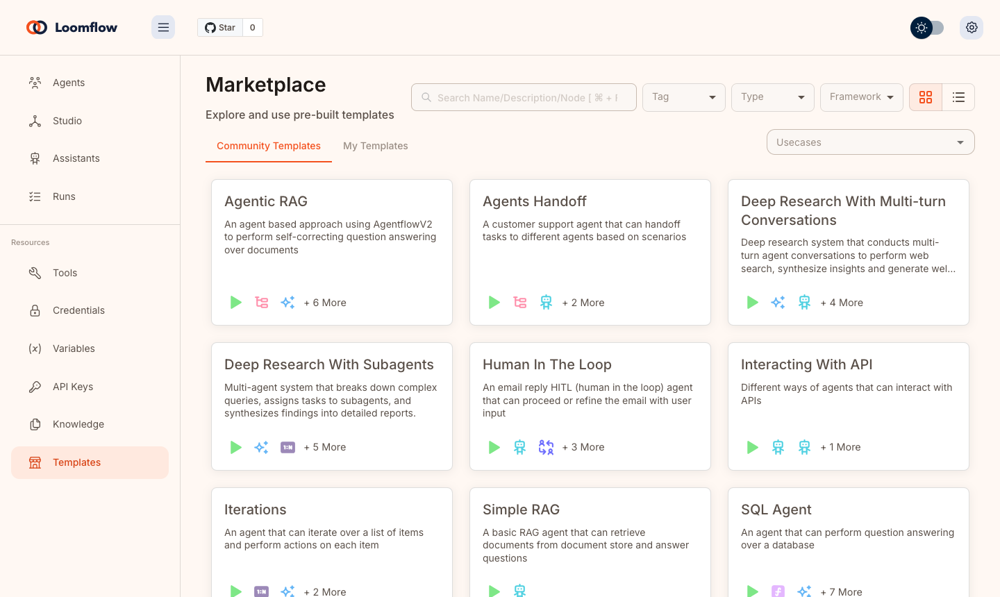
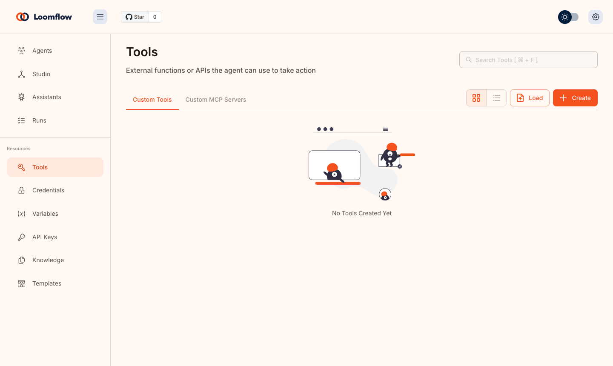
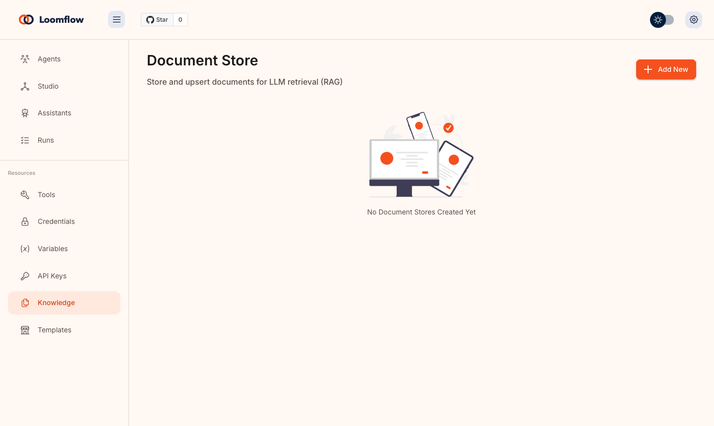

<!-- markdownlint-disable MD030 -->

<p align="center">


</p>

# Loomflow

<p align="center">
  
</p>

<p align="center"><a href="docs/demo.mp4">Watch the full demo video (2 minutes)</a></p>

**A visual builder for AI agents and workflows.** Drag nodes onto a canvas, thread them together, and ship agents, chat flows and automations without wiring everything by hand.

## Features

-   **Agents**: build single and multi-agent workflows on a visual canvas, with tools, memory, human-in-the-loop steps and iteration loops.
-   **Studio**: assemble chat flows from models, prompts, retrievers, vector stores and document loaders.
-   **Assistants**: configure ready-to-run assistants on top of your own tools and knowledge.
-   **Knowledge**: manage document stores, chunking, embeddings and vector upserts.
-   **Resources**: keep tools, credentials, variables and API keys in one place.
-   **Runs**: inspect executions, evaluate results and browse templates.
-   **Fresh canvas**: category-colored node headers, rounded cards, smooth coral edges and a dotted grid, in light and dark themes.
-   **Embed and API**: expose any flow through an API or an embeddable chat widget.

## Screenshots

| Agents | Studio |
| --- | --- |
|  |  |

| Multi-agent supervisor canvas | Agentic RAG canvas |
| --- | --- |
|  |  |

| Studio chat flow | Templates |
| --- | --- |
|  |  |

| Tools | Knowledge |
| --- | --- |
|  |  |

## Table of Contents

-   [Quick Start](#quick-start)
-   [Docker](#docker)
-   [Developers](#developers)
-   [Env Variables](#env-variables)
-   [Origin and licence](#origin-and-licence)
-   [Contributing](#contributing)

## Quick Start

Install [NodeJS](https://nodejs.org/en/download) >= 20.0.0 and [PNPM](https://pnpm.io/installation), then build from source:

```bash
pnpm install
pnpm build
pnpm start
```

Open [http://localhost:3000](http://localhost:3000). Loomflow opens on the Agents page.

Note: the npm package, CLI binary (`flowise`) and `FLOWISE_*` environment variables keep their original names so that existing configuration and integrations keep working.

## Docker

### Docker Compose

1. Go to the `docker` folder at the root of the project
2. Copy `.env.example` to `.env`
3. `docker compose up -d`
4. Open [http://localhost:3000](http://localhost:3000)
5. Bring the containers down with `docker compose stop`

### Docker Image

```bash
docker build --no-cache -t loomflow .
docker run -d --name loomflow -p 3000:3000 loomflow
docker stop loomflow
```

## Developers

Loomflow is organised as a monorepo:

-   `server`: Node backend that serves the API logic
-   `ui`: React frontend (MUI theme in `packages/ui/src/themes`)
-   `components`: third-party node integrations
-   `api-documentation`: auto-generated swagger-ui API docs

### Prerequisite

-   Install [PNPM](https://pnpm.io/installation)
    ```bash
    npm i -g pnpm
    ```

### Setup

1.  Clone the repository:

    ```bash
    git clone <your-loomflow-repository-url> loomflow
    ```

2.  Go into repository folder:

    ```bash
    cd loomflow
    ```

3.  Install all dependencies of all modules:

    ```bash
    pnpm install
    ```

4.  Build all the code:

    ```bash
    pnpm build
    ```

    <details>
    <summary>Exit code 134 (JavaScript heap out of memory)</summary>  
    If you get this error when running the above `build` script, try increasing the Node.js heap size and run the script again:

    ```bash
    # macOS / Linux / Git Bash
    export NODE_OPTIONS="--max-old-space-size=4096"

    # Windows PowerShell
    $env:NODE_OPTIONS="--max-old-space-size=4096"

    # Windows CMD
    set NODE_OPTIONS=--max-old-space-size=4096
    ```

    Then run:

    ```bash
    pnpm build
    ```

    </details>

5.  Start the app:

    ```bash
    pnpm start
    ```

    You can now access the app on [http://localhost:3000](http://localhost:3000)

6.  For development build:

    -   Create `.env` file and specify the `VITE_PORT` (refer to `.env.example`) in `packages/ui`
    -   Create `.env` file and specify the `PORT` (refer to `.env.example`) in `packages/server`
    -   Run:

        ```bash
        pnpm dev
        ```

    Any code changes will reload the app automatically on [http://localhost:8080](http://localhost:8080)

## Env Variables

Loomflow supports environment variables to configure your instance. Specify them in the `.env` file inside the `packages/server` folder.

## Licence

Loomflow is released under the [Apache License, Version 2.0](LICENSE.md). Keep the copyright and licence notices in [LICENSE.md](LICENSE.md) when you copy or redistribute the code. Content under `packages/server/src/enterprise` and any file carrying an explicit commercial copyright notice is covered by a separate commercial licence, so check it before use. See [NOTICE.md](NOTICE.md) for notices.

## Contributing

See the [Contributing Guide](CONTRIBUTING.md).

## License

Source code in this repository is made available under the [Apache License Version 2.0](LICENSE.md), subject to the commercial exception described above.
